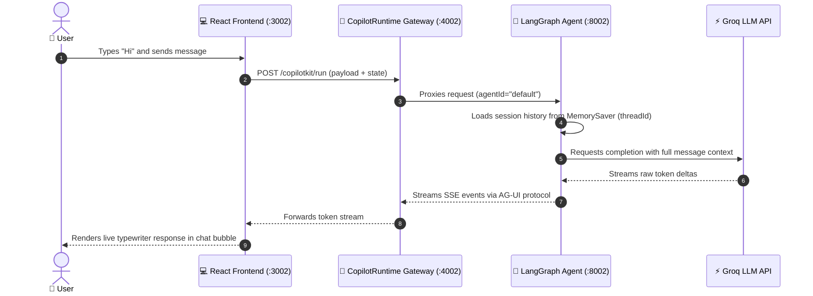

# YatriAI (यात्री AI) — Incredible India Travel Assistant 🇮🇳

An enterprise travel agent application dedicated exclusively to tourism and travel in India (Bharat). 
Powered by **CopilotKit**, a multi-agent API Gateway, and a backend agent server built with **LangGraph** (Groq / OpenAI) with strict domain guardrails.

---

## 🏛️ Features & Strict Scope

- **Exclusively India Travel**: Designed and guardrailed strictly for tourism, travel itineraries, transport (IRCTC trains, flights, cabs), heritage, culture, seasons, and regional cuisine across India.
- **Strict Out-of-Scope Rejection**: Non-travel queries (e.g. coding, world trivia, international travel outside India) are politely declined and redirected back to Indian destinations.
- **Budgeting in INR (₹)**: Clear budget projections (backpacker, mid-range, luxury).
- **Interactive UI**: Powered by CopilotKit React with custom Indian heritage branding.
- **Cross-Platform**: Fully compatible with Windows, macOS, and Linux out-of-the-box.

---

## 🏗️ Architecture

```text
React (:3002) ──► CopilotKit Runtime Gateway (:4002) ──► FastAPI LangGraph Agent (:8002) ──► LLM (Groq / OpenAI)
```

### Port Mapping & Services

| Port | Service | Tech Stack | Entry Point | Description |
| :--- | :--- | :--- | :--- | :--- |
| **3002** | Frontend Web App | React 19, Vite, TailwindCSS | `frontend/src/App.tsx` | YatriAI Chat UI with quick prompts |
| **4002** | Agent Gateway | Node.js, Hono, `@copilotkit/runtime` | `frontend/server.ts` | Multi-agent router & protocol bridge |
| **8002** | Travel Agent Backend | Python 3.12, FastAPI, LangGraph | `main.py` | YatriAI agent with session memory |

---

## 🚀 Quickstart & Setup

### 1. Prerequisites
- **Python**: 3.10 – 3.12 (Python 3.12 recommended)
- **Node.js**: 20+

### 2. Installation

```bash
# 1. Clone the repository
git clone https://github.com/basavraj0909/india-travel-agent.git
cd india-travel-agent

# 2. Setup Python virtual environment
# On macOS / Linux:
python3 -m venv venv
source venv/bin/activate

# On Windows (PowerShell):
python -m venv venv
.\venv\Scripts\Activate.ps1

# On Windows (Command Prompt):
python -m venv venv
venv\Scripts\activate.bat

# 3. Install Python dependencies
pip install -r requirements.txt

# 4. Setup Frontend dependencies
cd frontend
npm install
cd ..
```

### 3. Configure API Keys

Copy the example environment file:
```bash
cp .env.example .env
```
*(On Windows Command Prompt: `copy .env.example .env`)*

Open `.env` and set your active key. For example, using **Groq** for high-speed inference:
```ini
# Active API Key (Groq)
GROQ_API_KEY=your_groq_api_key_here

# Optional: choose model (default: "openai/gpt-oss-120b")
# GROQ_MODEL=openai/gpt-oss-120b

# Unused / Inactive Keys (Keep commented out when not in use)
# OPENAI_API_KEY=your_openai_api_key_here
# GOOGLE_API_KEY=your_google_api_key_here
```

---

## 💻 Running the Application

To run the full stack, open **two separate terminal windows**:

### Terminal 1: Backend Agent Server
```bash
# Activate virtual environment:
# macOS/Linux: source venv/bin/activate
# Windows PowerShell: .\venv\Scripts\Activate.ps1
# Windows CMD: venv\Scripts\activate.bat

# Option A: Run LangGraph Agent (Groq / OpenAI) - Port 8002
python main.py

# Option B: Run Google Gemini Agent - Port 8009
# python adk_server.py
```

### Terminal 2: Frontend UI & CopilotKit Gateway
```bash
cd frontend
npm run dev
```

This starts (cross-platform on Windows, macOS, and Linux):
- **CopilotKit API Gateway** at `http://localhost:4002`
- **React Web App** at `http://localhost:3002`

👉 Open your browser at **[http://localhost:3002](http://localhost:3002)** to chat!

---

## ☁️ Free Demo Deployment (Render)

The demo is deployed as three separate Render services, all connected to the
same GitHub repository and `main` branch:

| Service | Render service type | Root directory | Role |
| :--- | :--- | :--- | :--- |
| Python agent | Web Service (Python) | repository root (blank) | Runs FastAPI/LangGraph and calls the LLM |
| CopilotKit gateway | Web Service (Node) | `frontend` | Routes browser chat requests to the Python agent |
| React frontend | Static Site | `frontend` | Serves the built Vite application |

The currently deployed demo URLs are:

- Frontend: <https://india-travel-frontend2.onrender.com>
- Gateway: <https://india-travel-gateway.onrender.com>
- Python agent: <https://india-travel-agent.onrender.com>

These are deployment-specific examples; your service names and URLs may differ.

Render's free services may sleep while idle, making the first request slower.
Free-tier limits and eligibility can change; check
[Render pricing](https://render.com/pricing). The LLM provider also has separate
usage limits. Hosting the app does not make model API usage unlimited.

### 1. Deploy the Python agent

Create a **Web Service** from this repository:

- Branch: `main`
- Root directory: leave blank (repository root)
- Runtime: Python
- Build command: `pip install -r requirements.txt`
- Start command: `uvicorn main:app --host 0.0.0.0 --port $PORT`
- Instance type: Free, if available

Add these environment variables in the Python service's **Environment** page:

| Key | Value |
| :--- | :--- |
| `PYTHON_VERSION` | `3.12.10` |
| `GROQ_API_KEY` | Your Groq API key (enter it directly as a secret in Render) |
| `GROQ_MODEL` | Optional; defaults to `openai/gpt-oss-120b` |

`copilotkit==0.1.86` in `requirements.txt` supports Python 3.10 through 3.12,
so pin the Render service to Python 3.12. Do not put provider API keys in the
frontend or gateway service. Save the Python service's public URL for step 2.

### 2. Deploy the CopilotKit gateway

Create a second **Web Service** from the same repository:

- Branch: `main`
- Root directory: `frontend`
- Runtime: Node
- Build command:
  `npm ci --include=dev --registry=https://registry.npmjs.org/`
- Start command: `npm run start:gateway`
- Instance type: Free, if available

Set these variables in the gateway service's **Environment** page:

| Key | Value |
| :--- | :--- |
| `LANGGRAPH_DEPLOYMENT_URL` | Python agent URL, e.g. `https://india-travel-agent.onrender.com` |
| `FRONTEND_ORIGINS` | Exact frontend origin, e.g. `https://india-travel-frontend2.onrender.com` |

Use the origin only: no path and no trailing slash. If more than one frontend
origin needs access, separate the origins with commas. The gateway listens on
Render's assigned `PORT` and binds to `0.0.0.0`; those settings are handled by
`frontend/server.ts`.

The npm registry option is intentional. The lockfile uses public npm registry
tarball URLs; the explicit registry also avoids inheriting a private registry
default during installation.

### 3. Deploy the React frontend

Create a **Static Site** (not a Web Service) from the same repository:

- Branch: `main`
- Root directory: `frontend`
- Build command:
  `npm ci --include=dev --registry=https://registry.npmjs.org/ && npm run build`
- Publish directory: `dist`
- Instance type: Free, if available

Set this environment variable on the static site:

| Key | Value |
| :--- | :--- |
| `VITE_COPILOTKIT_RUNTIME_URL` | Gateway URL plus `/api/copilotkit`, e.g. `https://india-travel-gateway.onrender.com/api/copilotkit` |

Vite embeds this value into the frontend at build time. After changing it,
redeploy the static site. Once Render assigns the static site's URL, copy its
origin (for example `https://india-travel-frontend2.onrender.com`) into the
gateway's `FRONTEND_ORIGINS` variable and redeploy the gateway.

### 4. Verify the deployment

1. Open the frontend URL and confirm that the page and welcome message load.
2. Send a chat message and wait for an assistant reply. A successful page load
   by itself does not verify the gateway, Python agent, or model connection.
3. Check that the gateway info endpoint responds:
   `https://YOUR-GATEWAY.onrender.com/api/copilotkit/info`
4. If chat fails, check the Render logs for **both** the gateway and Python
   service, and verify all three URLs/environment settings above. The agent's
   root URL may return `405 Method Not Allowed` for a browser `GET`; it expects
   the agent protocol's `POST` requests, so that response alone does not mean
   the service is down.

### Troubleshooting deployment

- **Python build cannot find `copilotkit==0.1.86`:** set
  `PYTHON_VERSION=3.12.10` on the Python Web Service, then redeploy.
- **npm tries `airlock-proxy.uplink.goog:999`:** use the npm registry build
  command above. The committed `frontend/package-lock.json` replaces those
  inaccessible internal mirror URLs with public npm URLs.
- **`vite: not found`:** the frontend must be a **Static Site** with root
  directory `frontend`, not a Python Web Service. Its build command must run
  `npm ci` before `npm run build`.
- **Page loads, but chat stays blank after sending:** verify the frontend's
  `VITE_COPILOTKIT_RUNTIME_URL`, the gateway's `LANGGRAPH_DEPLOYMENT_URL` and
  `FRONTEND_ORIGINS`, and the backend's `GROQ_API_KEY`. Redeploy the service
  whose environment variable you changed.
- **npm reports audit vulnerabilities:** these warnings did not prevent the
  gateway build from succeeding. Review `npm audit` separately; avoid
  `npm audit fix --force` without reviewing potentially breaking dependency
  updates.

---

## 🛠️ Switching Between Agents

To switch the active agent in the frontend UI, open [`frontend/src/App.tsx`](frontend/src/App.tsx) and set `agentId`:

- **For Groq / OpenAI (`main.py` on `:8002`)**:
  ```tsx
  export const agentId = "default";
  ```
- **For Google Gemini (`adk_server.py` on `:8009`)**:
  ```tsx
  export const agentId = "gemini";
  ```

---

## 🧪 Testing

### 1. Automated Backend Test Suite
Run the built-in automated test suite to check health across all 3 tiers, response latency, and multi-turn session memory:
```bash
python test_agent.py
```

### 2. End-to-End (E2E) Browser Tests
Run automated Playwright tests simulating user interactions in the browser:
```bash
cd frontend
npm run test:e2e
```

---

## 🧰 Useful Commands

| Task                                | macOS / Linux                                                   | Windows (PowerShell)                                                                          | Windows (CMD)                                                                        |
| :---------------------------------- | :-------------------------------------------------------------- | :-------------------------------------------------------------------------------------------- | :----------------------------------------------------------------------------------- |
| **Activate venv**                   | `source venv/bin/activate`                                      | `.\venv\Scripts\Activate.ps1`                                                                 | `venv\Scripts\activate.bat`                                                          |
| **Run LangGraph backend**           | `python main.py`                                                | `python main.py`                                                                              | `python main.py`                                                                     |
| **Run Gemini backend**              | `python adk_server.py`                                          | `python adk_server.py`                                                                        | `python adk_server.py`                                                               |
| **Run Frontend & Gateway**          | `cd frontend && npm run dev`                                    | `cd frontend && npm run dev`                                                                  | `cd frontend && npm run dev`                                                         |
| **Run test suite**                  | `python test_agent.py`                                          | `python test_agent.py`                                                                        | `python test_agent.py`                                                               |
| **Kill hanging processes on ports** | `lsof -ti :3002 -ti :4002 -ti :8002 -ti :8009 \| xargs kill -9` | `Stop-Process -Id (Get-NetTCPConnection -LocalPort 3002,4002,8002,8009).OwningProcess -Force` | `for /f "tokens=5" %a in ('netstat -aon ^\| findstr :3002') do taskkill /f /pid %a`  |
| **Check open ports**                | `lsof -i :3002 -i :4002 -i :8002 -i :8009`                      | `Get-NetTCPConnection -LocalPort 3002,4002,8002,8009`                                         | `netstat -ano \| findstr LISTENING`                                                  |

---

## 💡 How It Works Under the Hood

### 🔄 The Life of a Single Message

When you send a message (e.g. `"Hi"`) from `http://localhost:3002`:



#### Step-by-Step Flow:

1. **Client Dispatch (`React :3002`)**  
   The user enters a prompt. CopilotKit hooks intercept the input, attach the active conversation state, and issue a request to the runtime gateway.

2. **Gateway Resolution (`Hono Gateway :4002`)**  
   The gateway checks `agentId = "default"` and routes the payload to the corresponding Python backend.

3. **Context Reconstruction (`LangGraph :8002`)**  
   LangGraph loads conversation history from `MemorySaver` using the session's `threadId`, constructs the complete prompt context, and executes the graph.

4. **Inference Execution (`Groq API`)**  
   Groq processes the prompt using ultra-low-latency LPU inference (`openai/gpt-oss-120b`) and streams token chunks back to LangGraph.

5. **SSE Protocol Streaming (`AG-UI Protocol`)**  
   LangGraph wraps the output into Server-Sent Events (SSE) via `CopilotKitMiddleware`. Tokens stream through the Gateway and render live in the React chat bubble.

---

### ⚖️ Traditional Chatbot vs. Agentic Architecture

| Feature                | Simple Chatbot (Toy Project)                     | This Project (Agentic Architecture)                                                          |
| :--------------------- | :----------------------------------------------- | :------------------------------------------------------------------------------------------- |
| **Architecture**       | Single-tier (React directly calls LLM REST API)  | **3-Tier Decoupled Gateway Pattern** (`React :3002` ➔ `Gateway :4002` ➔ `Agent :8002` ➔ `LLM`) |
| **Provider Agnostic**  | Hardcoded to a single vendor (e.g. OpenAI only)  | **Hot-Swappable Multi-Provider**: Toggle **Groq**, **OpenAI**, or **Gemini** via config      |
| **Streaming Protocol** | Static JSON payload (`{"reply": "..."}`)         | **AG-UI Streaming Protocol**: Server-Sent Events (SSE) streaming real-time token deltas      |
| **Execution Engine**   | Single prompt string sent to API                 | **LangGraph State Machine**: Directed cyclic graphs with conditional edges and tools         |
| **State & Memory**     | Ephemeral (lost on refresh or in `localStorage`) | **Server-Side Checkpointing**: Thread-safe persistence via `MemorySaver` and `threadId`      |
| **UI Interaction**     | Plain markdown text bubbles only                 | **Generative UI**: Agents dynamically control rich interactive React UI widgets               |
